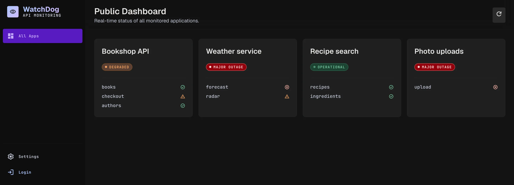
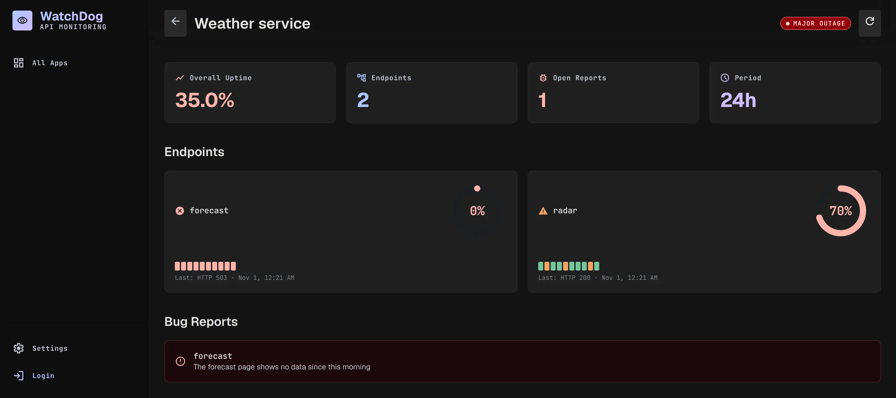

# APIWatchdog

WatchDog, a status page for your APIs. Register an app and its endpoint URLs; the server polls each one, keeps the last ten answers and shows whether the app is operational, degraded or down.

<p align="center">
  
</p>

Anyone can open the public dashboard, see each app's uptime, last answers and open reports, and file a bug report. Signed-in owners get their own dashboard where they add apps and endpoints. A settings dialog sets how often the server polls.

<p align="center">
  
</p>

Three npm workspaces: `packages/be` is an Express 5 API on SQLite that runs the polling, `packages/fe` is a React and Tailwind page, and `packages/shared` holds the types both use. It started at a hackathon in April 2024 and was rebuilt in June 2026.

## Run it

```bash
npm install
npm run dev:be       # the API on port 3000
npm run dev:fe       # second terminal: http://localhost:5173
```

The list starts empty; `node playwright/scripts/seed.cjs` adds a test user and two apps. Variables and details: [../docs/getting-started.md](../docs/getting-started.md#apiwatchdog). The project wiki, with the architecture, the design system and the UI test plans, is in [corpus/](corpus/index.md).
