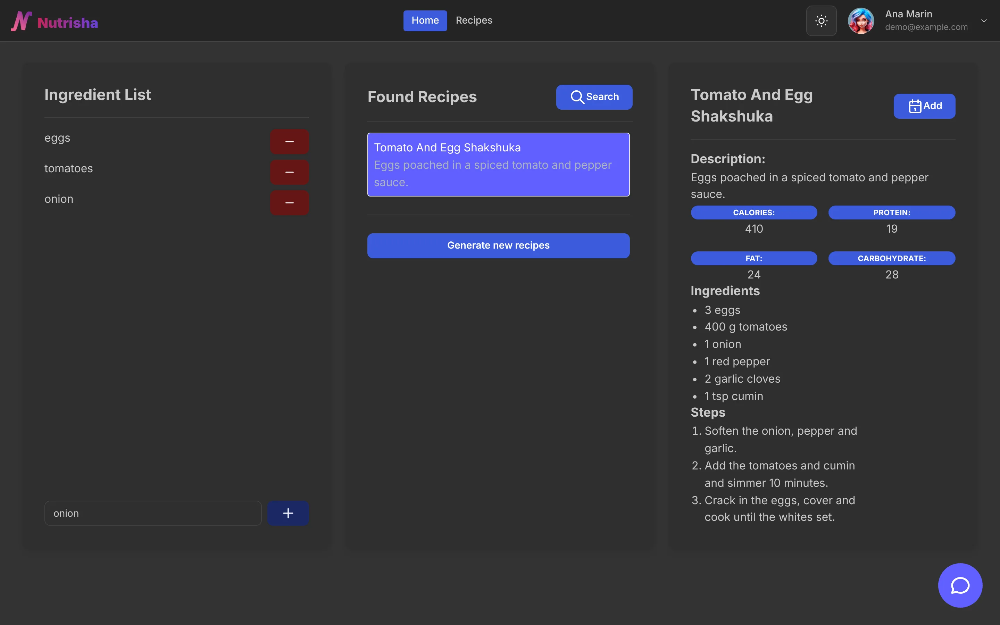
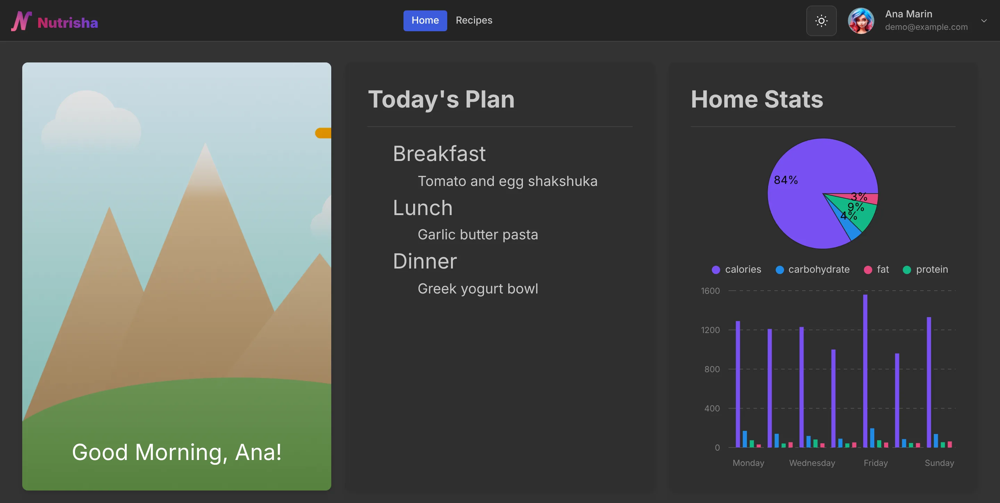
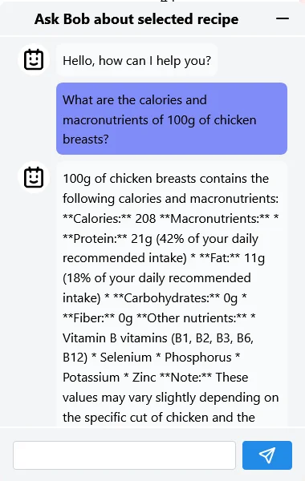

# ITFest - Nutrisha

A web app that joins an AI assistant to a meal planner: find recipes from what is in your fridge, see their nutrition, ask about them, and plan the week's meals. It was made at the ITFest hackathon in March 2024.

<p align="center">
  
</p>

## Composition Team - BMG

- Bran Alexandru
- Mateian Tudor
- Gusatu Cristian

## Description

The main objectives of this application are to:

- help people find recipes with the ingredients they have in the fridge
- show their nutritional values, and answer questions about them without reading a lot of documentation
- plan and watch their diet during the week

### How it works

You give a list of ingredients and the app searches its database for recipes that contain them. If you don't like any of those, **Generate new recipes** asks the LLM for more.

Once you find something you like, select it to see its nutritional values, the full list of ingredients and the cooking steps. For more information, ask the chat assistant in the bottom-right corner.

If everything is all right, add the recipe to any meal of any day, and see the resulting stats on the home page.

## App screens

<table>
<tr>
<td width="62%" valign="top"></td>
<td width="38%" valign="top"></td>
</tr>
</table>

The home and recipe screens were taken on 2026-11-01 with a demo user and made-up recipes. The chat panel is from the 2024 hackathon; it needs an Ollama Cloud key to run. The original 2024 screenshots, light and dark, are in [Screenshoots/](Screenshoots/).

## Technical description

The project is organized as an **npm workspaces** monorepo:

```
packages/
├── shared/     @nutrisha/shared   – TypeScript domain types shared by FE & BE
├── backend/    @nutrisha/backend  – Fastify + TypeScript + SQLite CRUD API
└── frontend/   @nutrisha/frontend – React + Vite + Mantine UI
OllamaAPI/                          – Python/Flask LLM service (separate)
```

### Frontend

The interface is in React, using:

- Mantine component library
- TailwindCSS
- Axios

### Backend

The backend is split into two APIs, one for the LLM and one for the base CRUD operations.

The LLM API is built with Python and Flask, and calls Ollama Cloud (see [OllamaAPI/](OllamaAPI/README.md)). The CRUD API was first written in Java with Spring Boot and has since been ported to **Fastify + TypeScript** (see [packages/backend/](packages/backend/README.md)), backed by a local SQLite file. It exposes the same `/auth`, `/users` and `/recipes` endpoints on port `8080`.

### Running it

```bash
# install all workspaces
npm install

# build the shared types, which the backend imports
npm run build --workspace @nutrisha/shared

# start the Fastify backend (SQLite file in packages/backend/data/)
npm run dev:backend

# start the React frontend on http://localhost:5173
npm run dev:frontend
```

The Python LLM service runs separately from the `OllamaAPI/` directory, with an Ollama Cloud API key in its `.env`. More: [../docs/getting-started.md](../docs/getting-started.md#itfest-nutrisha).

## License

MIT, see [LICENSE](LICENSE).
