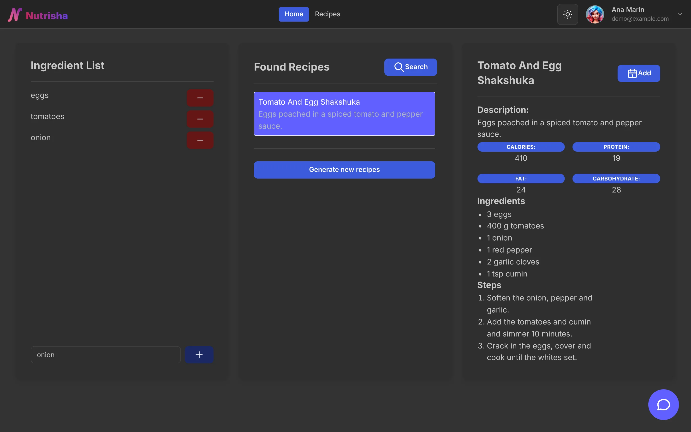
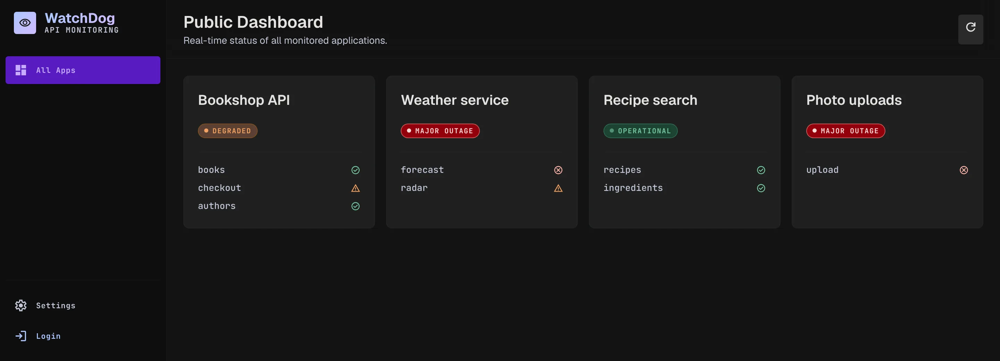
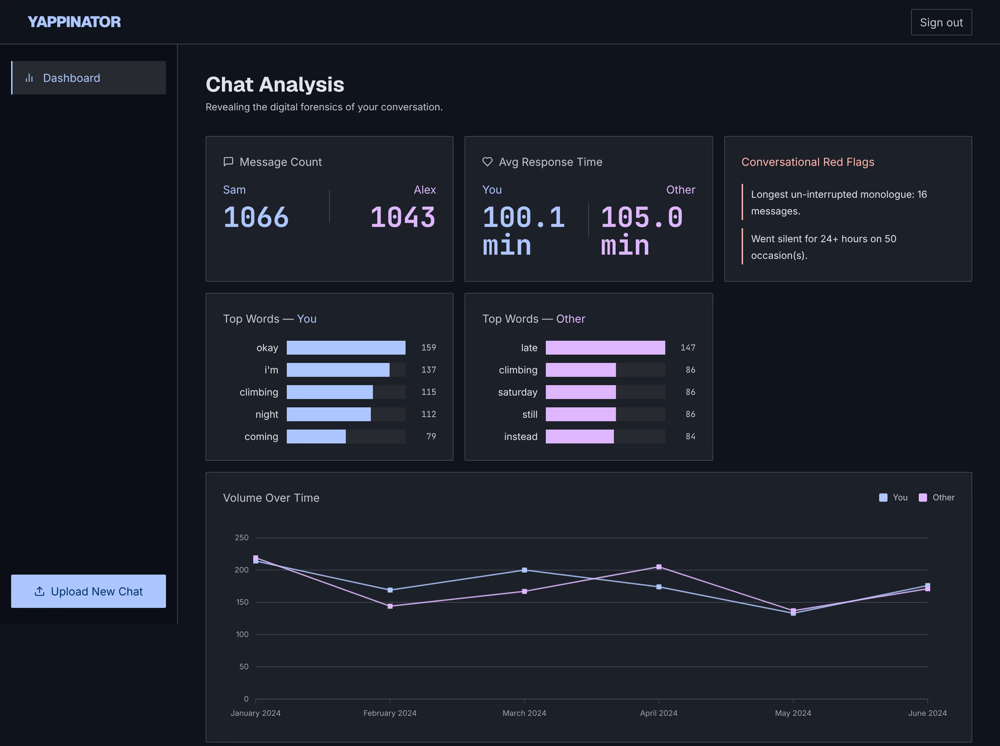
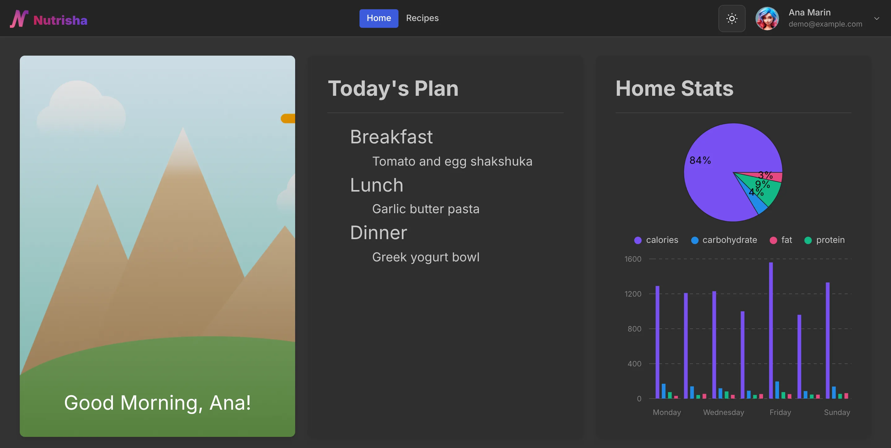
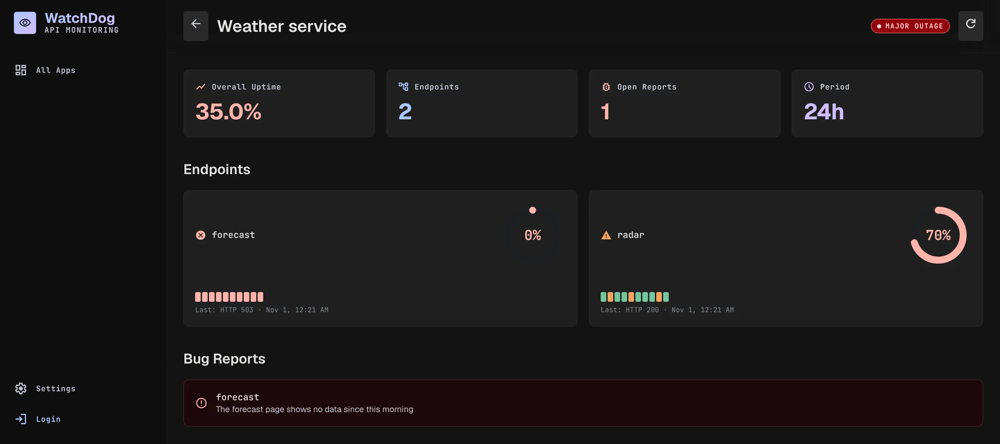

# hackathons

Three projects that started at hackathons between 2024 and 2025 and were reworked in June 2026, kept in one repo with their commit histories: an AI meal planner, an API uptime monitor and a WhatsApp chat analyser.

<p align="center">
  
</p>

**Status:** Finished projects, kept for reference. None is deployed. All three run on your own machine with SQLite. Only Nutrisha's recipe generator and chat need an outside service: its small Python service calls Ollama Cloud with your API key. The original repositories are no longer public; this repo keeps their history.

## What is in it

| Folder | What it is | Built with | Started |
|---|---|---|---|
| [ITFest-Nutrisha/](ITFest-Nutrisha/) | Find recipes from what is in your fridge, plan the week's meals and ask a chat assistant about a recipe. Built by a team of three at ITFest. | React and Mantine, Fastify, SQLite, Flask with Ollama Cloud for the LLM | March 2024 |
| [APIWatchdog/](APIWatchdog/) | WatchDog, a status page for your APIs. It polls each endpoint, keeps the last ten answers and shows uptime per app. | React and Tailwind, Express 5, SQLite | April 2024 |
| [Yappinator-One-Thousand/](Yappinator-One-Thousand/) | Upload a WhatsApp chat export and get a "Wrapped"-style dashboard: who writes more, reply times, top words, red flags and messages per month. | React and Tailwind, Express 5, SQLite | March 2025 |

In June 2026 all three moved to npm workspaces and SQLite, and APIWatchdog and Yappinator got new dark designs.

## Screenshots

<table>
<tr>
<td width="50%" valign="top"></td>
<td width="50%" valign="top"></td>
</tr>
<tr>
<td width="50%" valign="top"></td>
<td width="50%" valign="top"></td>
</tr>
</table>

## Run one

Each folder installs and runs on its own. All three need Node 20 or newer. From the repo root, one at a time:

```bash
cd APIWatchdog && npm install && npm run dev:be     # API on :3000, then `npm run dev:fe` in a second terminal
cd Yappinator-One-Thousand && npm install && npm run dev
cd ITFest-Nutrisha && npm install && npm run build --workspace @nutrisha/shared && npm run dev:backend   # then `npm run dev:frontend`
```

Each opens on http://localhost:5173. Ports, demo data, Nutrisha's LLM service and a fix for a missing native module on Linux: [docs/getting-started.md](docs/getting-started.md).

## How the repo was made

Each project was its own repository first. In July 2026 they were merged here with `git subtree`, one folder each, so `git log` still shows every original commit.

## Docs

- [docs/](docs/README.md): setup for every project and how the images were made
- Each folder's README; APIWatchdog and Yappinator also keep a `corpus/` wiki with their design, decisions and UI test plans
- Repo-wide wiki: [corpus/](corpus/index.md)

## License

Nutrisha and Yappinator carry their own MIT license files. APIWatchdog has none, so all rights are reserved for it.
